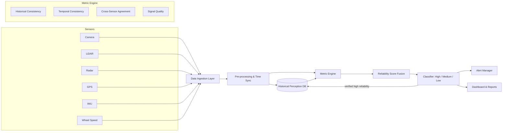
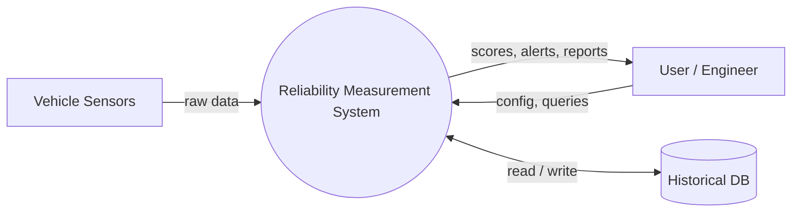
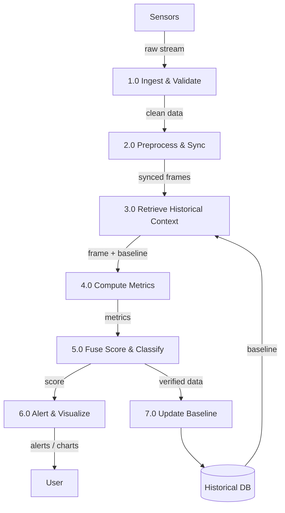
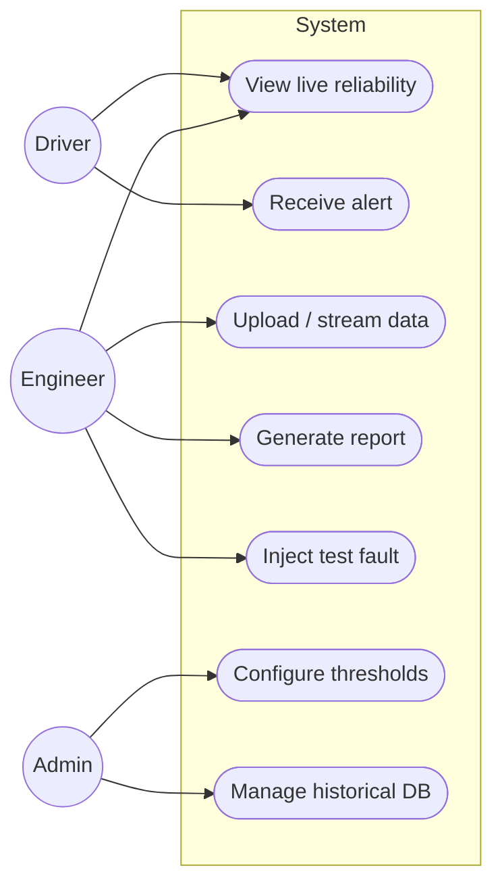
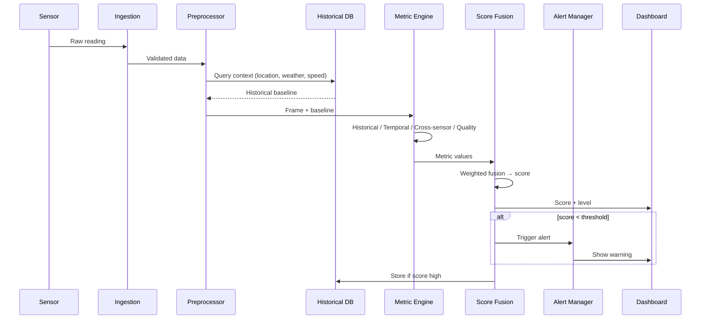
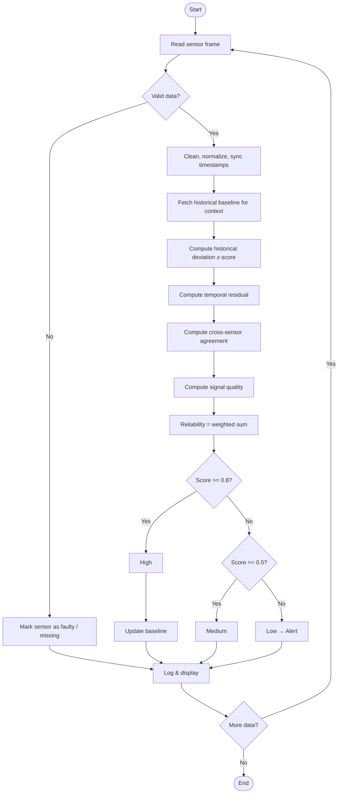
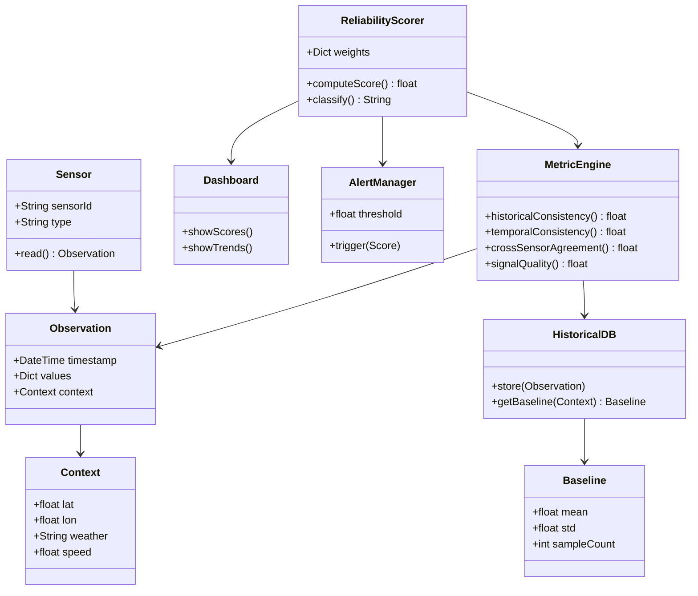
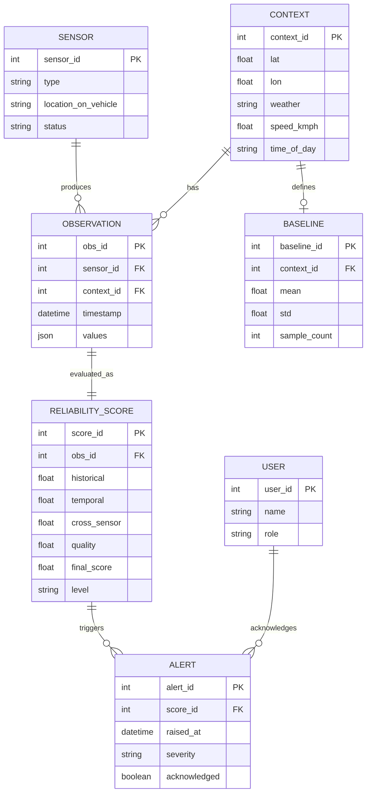
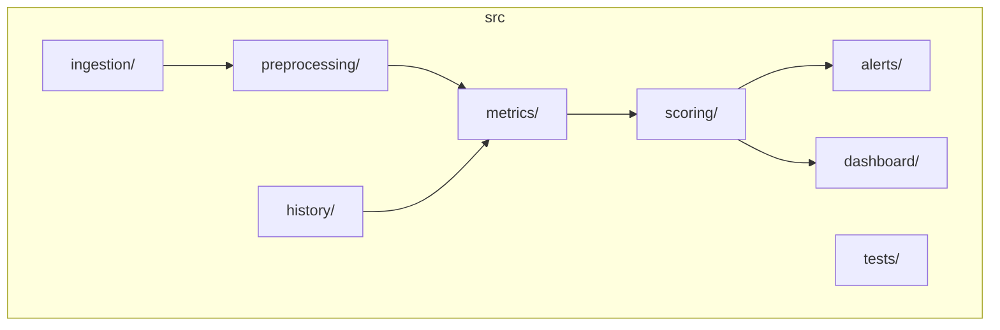

# 03 – System Design & Diagrams

All diagrams use [Mermaid](https://mermaid.js.org/) and render automatically on GitHub.

---

## 1. System Architecture

---

## 2. Data Flow Diagram – Level 0 (Context)

## 3. Data Flow Diagram – Level 1

---

## 4. Use Case Diagram

---

## 5. Sequence Diagram – Scoring a Sensor Reading

---

## 6. Activity / Flowchart – Main Algorithm

---

## 7. Class Diagram

---

## 8. ER Diagram (Database)

---

## 9. Component / Module Layout

---

## 10. Reliability Score Formulae
| Metric | Formula |
|--------|---------|
| Historical Consistency (H) | `H = exp(-\|x - μ\| / (k·σ))` where μ, σ come from the historical baseline |
| Temporal Consistency (T) | `T = exp(-r² / σ_r²)` where r is the Kalman/predicted residual |
| Cross-Sensor Agreement (C) | `C = 1 - normalized_difference(sensor_A, sensor_B)` |
| Signal Quality (Q) | `Q = w_snr·SNR_norm + w_d·(1 - dropout_rate)` |
| **Final Score (R)** | `R = w1·H + w2·T + w3·C + w4·Q` with `Σw = 1` (default 0.35, 0.25, 0.25, 0.15) |

| Level | Range |
|-------|-------|
| High | R ≥ 0.80 |
| Medium | 0.50 ≤ R < 0.80 |
| Low | R < 0.50 |
