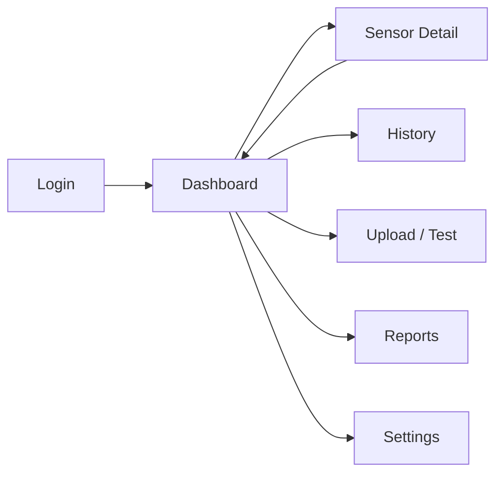

# 04 – UI Design

Low-fidelity wireframes for the web dashboard.

## Design Principles
- Colour coding: 🟢 High (≥0.8) · 🟡 Medium (0.5–0.8) · 🔴 Low (<0.5)
- Most important information (current score and alerts) at the top
- Minimal clicks to reach any sensor's detail
- Dark/light theme, responsive layout

---

## Screen 1 – Login
```
+--------------------------------------------+
|   Vehicle Sensor Reliability Monitor       |
|                                            |
|   Username: [______________________]       |
|   Password: [______________________]       |
|   Role:     [ Engineer v ]                 |
|                                            |
|            [   Login   ]                   |
+--------------------------------------------+
```

## Screen 2 – Main Dashboard
```
+------------------------------------------------------------------+
| Reliability Monitor   [Dashboard][Sensors][History][Reports][⚙]   |
+------------------------------------------------------------------+
| Overall Reliability:  0.86  🟢 HIGH          Alerts: 1 active     |
+------------------------------------------------------------------+
| Sensor        | Score | Status | Trend (last 5 min)              |
|---------------|-------|--------|---------------------------------|
| Camera        | 0.72  | 🟡 MED | ▂▃▃▄▃▂▂                         |
| LiDAR         | 0.91  | 🟢 HIGH| ▆▆▇▇▇▆▇                         |
| Radar         | 0.88  | 🟢 HIGH| ▅▆▆▆▇▆▆                         |
| GPS           | 0.41  | 🔴 LOW | ▇▆▅▃▂▂▁                         |
| IMU           | 0.93  | 🟢 HIGH| ▇▇▇▇▇▇▇                         |
| Wheel Speed   | 0.89  | 🟢 HIGH| ▆▆▇▆▆▇▆                         |
+------------------------------------------------------------------+
| [ Live reliability line chart over time                         ] |
|                                                                  |
+------------------------------------------------------------------+
| ⚠ ALERT 10:15:32 – GPS reliability dropped below 0.5   [Ack]     |
+------------------------------------------------------------------+
```

## Screen 3 – Sensor Detail
```
+------------------------------------------------------------------+
| ← Back     Sensor: GPS_01                    Score: 0.41 🔴      |
+------------------------------------------------------------------+
| Metric breakdown                                                 |
|  Historical Consistency  [███░░░░░░░] 0.30                       |
|  Temporal Consistency    [█████░░░░░] 0.50                       |
|  Cross-Sensor Agreement  [████░░░░░░] 0.40                       |
|  Signal Quality          [██████░░░░] 0.60                       |
+------------------------------------------------------------------+
| Live value vs Historical baseline (chart with ±σ band)           |
+------------------------------------------------------------------+
| Possible cause: sudden position jump (possible spoofing/multipath)|
| [Export data]  [Mark as false alarm]                             |
+------------------------------------------------------------------+
```

## Screen 4 – Historical Data
```
+------------------------------------------------------------------+
| Date range: [01-11-2026] to [02-11-2026]  Sensor: [All v]  [Go]  |
+------------------------------------------------------------------+
| Time      | Sensor | Score | Level | Weather | Location         |
| 10:15:30  | GPS_01 | 0.41  | Low   | Clear   | 17.385,78.486    |
| 10:15:29  | LIDAR  | 0.91  | High  | Clear   | 17.385,78.486    |
| ...                                                              |
+------------------------------------------------------------------+
| [Prev] 1 2 3 [Next]                          [Download CSV]      |
+------------------------------------------------------------------+
```

## Screen 5 – Upload / Test Mode
```
+------------------------------------------------------------------+
| Data Source: (•) Upload file  ( ) Live stream  ( ) Simulator      |
| [ Choose file... ]  dataset.csv                                  |
|                                                                  |
| Fault Injection                                                  |
|  Sensor: [Camera v]  Type: [Noise | Bias | Dropout | Spoof]      |
|  Intensity: [====|-----] 40%       [Inject]                      |
|                                                                  |
| [ Start Analysis ]                                               |
+------------------------------------------------------------------+
```

## Screen 6 – Settings
```
+------------------------------------------------------------------+
| Metric weights        Historical [0.35]  Temporal [0.25]         |
|                       Cross-sensor [0.25] Quality [0.15]         |
| Thresholds            High ≥ [0.80]   Medium ≥ [0.50]            |
| Alert method          [x] Dashboard  [ ] Email  [ ] Sound        |
| Baseline update       [x] Auto-update with high-reliability data |
|                                          [Save] [Reset]          |
+------------------------------------------------------------------+
```

## Screen 7 – Reports
```
+------------------------------------------------------------------+
| Report type: [Daily summary v]   Format: [PDF v]   [Generate]    |
| Contents: average score per sensor, alert count, failure periods |
+------------------------------------------------------------------+
```

## Navigation Flow


## Suggested Tools for High-Fidelity Mockups
Figma, Streamlit prototype, or Draw.io. Export screenshots into a `docs/ui/` folder.
